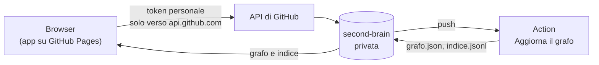

# Second brain · app web

Questa app serve a leggere, scrivere e collegare le note del [second brain](https://github.com/voltalacarta/second-brain) dal browser, da qualunque computer o telefono.

**Indirizzo:** <https://voltalacarta.github.io/second-brain-app/>

Questa repo è pubblica ma contiene **solo codice**. Le note restano nella repo privata e l'app le legge e le salva direttamente lì, con l'API di GitHub e un token personale che non esce dal tuo browser.



## Cosa fa

| | |
|---|---|
| **Leggi** | Note in Markdown con tabelle, avvisi, attività, immagini private, link e `[[wikilink]]`. Mostra anche i documenti di `documentazione`, in sola lettura. |
| **Collegamenti** | Per ogni nota: chi la cita, cosa cita, i concetti e il grafo locale. I dati vengono dall'Action del second brain. |
| **Grafo** | Il grafo completo di tutte le repo, con filtri, ricerca, zoom e tocco. Un tocco seleziona un nodo, il secondo lo apre. |
| **Cerca** | Ricerca istantanea su titoli, sintesi e concetti (tasto `/`). C'è anche la ricerca dentro il testo, che usa quella di GitHub. |
| **Scrivi** | Editor con anteprima affiancata, barra degli strumenti, suggerimenti `[[`, elenchi che continuano da soli, `Ctrl+S` e allegati. |
| **Nuove note** | Dai modelli di `_modelli/` (tasto `n`). La nota del giorno va in `01-giornaliere/` (tasto `o`). |
| **Attività** | Spunti `- [ ]` direttamente nella nota: un clic, un commit. |
| **Archivia e sposta** | Un solo commit atomico. Nel second brain non si cancella niente: si archivia in `40-archivio/`. |
| **Sicurezza dei dati** | Bozze salvate da sole, avviso se esci con modifiche non salvate, rilevamento dei conflitti se la nota è cambiata altrove. |
| **Telefono** | Interfaccia adattiva. Si può installare come app («Aggiungi alla schermata Home»). |

Ogni salvataggio è un commit (`note: …`) sulla repo. Dopo circa un minuto l'Action **Aggiorna il grafo** rigenera grafo e indice, e l'app li ricarica da sola.

## Primo accesso: il token

1. Su GitHub apri **Settings → Developer settings → Fine-grained tokens → Generate new token**. Il link nella schermata di accesso dell'app compila già quasi tutto.
2. **Resource owner:** `voltalacarta` · **Expiration:** 90 giorni.
3. **Repository access:** *Only select repositories* → `second-brain`.
4. **Permissions:**
   - *Contents*: **Read and write**;
   - facoltativo: *Actions*: Read, per vedere quando il grafo è aggiornato.
5. Incolla il token nell'app.
   - Con **Ricorda su questo dispositivo** il token resta nel browser.
   - Senza, sparisce quando chiudi la scheda.

Alla scadenza, l'app chiede un token nuovo.

## Sicurezza

- **Nessun server.** L'app è statica e parla solo con `api.github.com`. Una Content Security Policy rigida lo impone: `connect-src https://api.github.com`, `script-src 'self'`, niente script di terzi né CDN.
- **Il token:**
  - finisce solo nell'intestazione `Authorization`, mai negli URL;
  - non è mai nella cache del service worker, che conserva solo i file dell'app;
  - **Esci** lo cancella insieme a bozze e cache.
- **Il Markdown non diventa mai HTML grezzo.** Il renderer (`src/js/md.js`, scritto qui e senza dipendenze) applica l'escape a tutto il testo e genera solo i tag previsti. I link possono essere solo `http`, `https`, `mailto` o interni: `javascript:` e simili non passano.
- **Contro il clickjacking:** l'app si rifiuta di aprirsi dentro un `iframe`.
- **Permessi minimi:** il token fine-grained vale per una sola repo e solo per i contenuti.
- **File protetti:** i file generati (`_grafo/`, `grafo.md`, `.github/`) sono in sola lettura anche nell'app.

## Sviluppo

Non ci sono dipendenze da installare.

```bash
npm test                  # test unitari (node --test)
npm run build             # src/ → dist/ con la versione timbrata
npm run e2e               # Chromium vero + API di GitHub simulata (serve Playwright)
SB_SCREENSHOT=foto npm run e2e   # come sopra, salvando le schermate
```

Le prove end-to-end usano due repo **inventate** in `test/fixture/`, così in questa repo pubblica non finisce nessuna nota vera. Il loro grafo è generato con lo stesso motore del second brain.

| Percorso | Contenuto |
|---|---|
| `src/index.html`, `src/app.css` | Pagina e stile (chiaro e scuro) |
| `src/js/main.js` | Viste, navigazione, salvataggi, ricerca |
| `src/js/github.js` | Client dell'API di GitHub, con commit atomici a più file e controllo dei conflitti |
| `src/js/md.js` | Renderer Markdown sicuro |
| `src/js/editor.js` | Editor |
| `src/js/grafo.js` | Grafo su canvas: forze su griglia, zoom e tocco |
| `src/js/util.js` | Funzioni pure (percorsi, frontmatter, wikilink, base64) |
| `src/sw.js`, `src/manifest.webmanifest` | App installabile; mette in cache solo il codice |
| `.github/workflows/pubblica.yml` | Test e pubblicazione su GitHub Pages a ogni push su `main` |

## Pubblicazione

L'Action **Test e pubblicazione** parte a ogni push su `main`:

1. esegue i test unitari;
2. compila l'app;
3. esegue le prove nel browser, salvando le schermate come artefatto;
4. se tutto passa, pubblica `dist/` su GitHub Pages.

Una pull request esegue solo i test.

Impostazione richiesta, una volta sola: **Settings → Pages → Source: GitHub Actions**.

Decisione di riferimento: `documentazione/10-decisioni/0008-app-web-del-second-brain-su-github-pages.md`.
