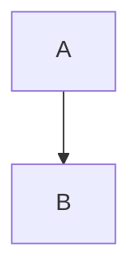

# Progetto demo

> [!NOTE]
> Un progetto finto per i test dell'app.

## Tabella

| Voce | Stato | Note |
|------|:-----:|------|
| Cookie | 🔴 Da fare | banner con «Rifiuta» |
| Recesso | ✅ | `pulsante` attivo |

## Collegamenti

- [Area strumenti](../../20-aree/strumenti.md#stripe)
- [Sito esterno](https://example.org)
- 

## Attività

1. primo
2. secondo
   - sotto
