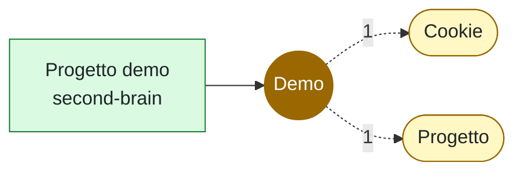

# Demo

<!-- File generato da .github/kg: non modificarlo a mano, viene riscritto a ogni aggiornamento. -->

**Tag** · 1 file in 1 repo · da: tag

## Dove compare

### [second-brain](../repo/repo-second-brain.md) (1)

- 🏷️ [Progetto demo](../../10-progetti/demo/README.md) — [!NOTE] Un progetto finto per i test dell'app.

## Concetti vicini

Compaiono spesso negli stessi file:

[Cookie](cookie.md) (1) · [Progetto](progetto.md) (1)
