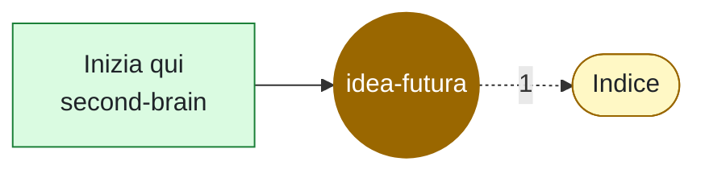

# idea-futura

<!-- File generato da .github/kg: non modificarlo a mano, viene riscritto a ogni aggiornamento. -->

> **Nota da creare.** Qualcuno la cita con `[[idea-futura]]` ma non esiste ancora. Creala nel second brain (per esempio in `20-aree/` o `30-risorse/`) con lo stesso nome: da quel momento sarà lei a rappresentare questo concetto.

**Da creare** · 1 file in 1 repo · da: wikilink

## Dove compare

### [second-brain](../repo/repo-second-brain.md) (1)

- [Inizia qui](../../inizia-qui.md) — Benvenuto nel second brain di prova. Vai al progetto demo oppure leggi benvenuto.

## Concetti vicini

Compaiono spesso negli stessi file:

[Indice](indice.md) (1)
