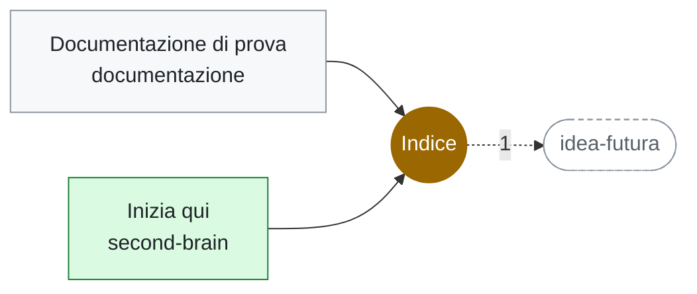

# Indice

<!-- File generato da .github/kg: non modificarlo a mano, viene riscritto a ogni aggiornamento. -->

**Tag** · 2 file in 2 repo · da: tag

## Dove compare

### [documentazione](../repo/repo-documentazione.md) (1)

- 🏷️ [Documentazione di prova](../documenti/documentazione/documentazione-di-prova.md) — Decisioni: 0001.

### [second-brain](../repo/repo-second-brain.md) (1)

- 🏷️ [Inizia qui](../../inizia-qui.md) — Benvenuto nel second brain di prova. Vai al progetto demo oppure leggi benvenuto.

## Concetti vicini

Compaiono spesso negli stessi file:

[idea-futura](idea-futura.md) (1)
