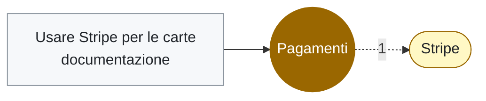

# Pagamenti

<!-- File generato da .github/kg: non modificarlo a mano, viene riscritto a ogni aggiornamento. -->

**Tag** · 1 file in 1 repo · da: tag

## Dove compare

### [documentazione](../repo/repo-documentazione.md) (1)

- 🏷️ [Usare Stripe per le carte](../documenti/documentazione/usare-stripe-per-le-carte.md) — Si usa Stripe come gateway.

## Concetti vicini

Compaiono spesso negli stessi file:

[Stripe](stripe.md) (1)
