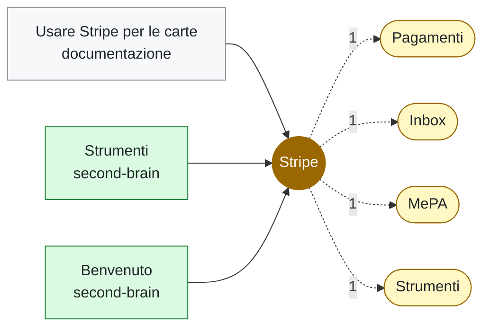

# Stripe

<!-- File generato da .github/kg: non modificarlo a mano, viene riscritto a ogni aggiornamento. -->

**Strumenti** · 3 file in 2 repo · da: vocabolario

## Dove compare

### [second-brain](../repo/repo-second-brain.md) (2)

- [Strumenti](../../20-aree/strumenti.md) — Usiamo Stripe per le carte. Vedi anche il progetto demo e benvenuto.
- [Benvenuto](../../00-inbox/benvenuto.md) — Prima nota. Parla di Stripe e di MePA.

### [documentazione](../repo/repo-documentazione.md) (1)

- [Usare Stripe per le carte](../documenti/documentazione/usare-stripe-per-le-carte.md) — Si usa Stripe come gateway.

## Concetti vicini

Compaiono spesso negli stessi file:

[Pagamenti](pagamenti.md) (1) · [Inbox](inbox.md) (1) · [MePA](mepa.md) (1) · [Strumenti](../../20-aree/strumenti.md) (1)
