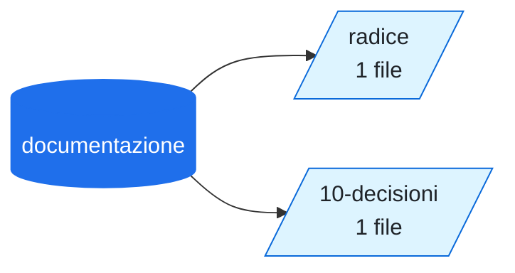

# 📦 documentazione

<!-- File generato da .github/kg: non modificarlo a mano, viene riscritto a ogni aggiornamento. -->

> Decisioni: 0001.

[Apri su GitHub](https://github.com/voltalacarta/documentazione) · pubblica · 2 file Markdown

## Mappa delle cartelle

L'albero delle cartelle con quanti file contiene ciascuna; le frecce tratteggiate sono i rimandi più frequenti tra cartelle.

## Concetti principali

[Pagamenti](../concetti/pagamenti.md) (1), [Stripe](../concetti/stripe.md) (1), [Indice](../concetti/indice.md) (1)

## File

### `(radice)`

| File | Sintesi | Stato |
| --- | --- | --- |
| [Documentazione di prova](../documenti/documentazione/documentazione-di-prova.md) | Decisioni: 0001. | attivo |

### `10-decisioni`

| File | Sintesi | Stato |
| --- | --- | --- |
| [Usare Stripe per le carte](../documenti/documentazione/usare-stripe-per-le-carte.md) | Si usa Stripe come gateway. | accettato |
