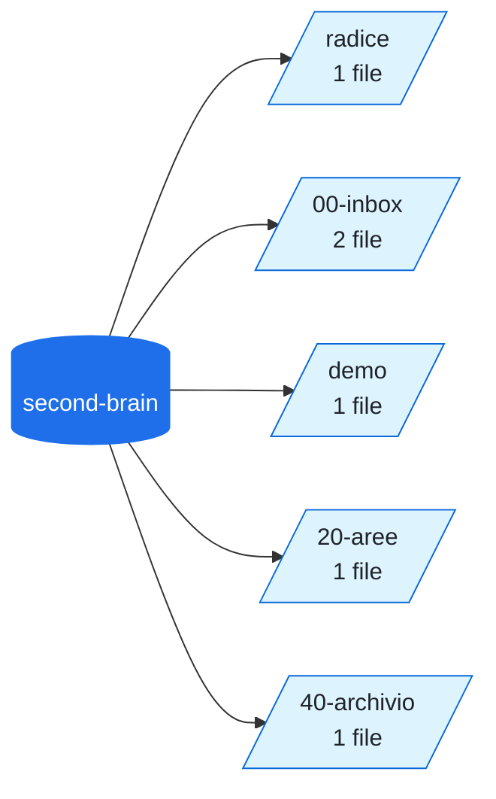

# 📦 second-brain

<!-- File generato da .github/kg: non modificarlo a mano, viene riscritto a ogni aggiornamento. -->

[Apri su GitHub](https://github.com/voltalacarta/second-brain) · privata 🔒 · 6 file Markdown

## Mappa delle cartelle

L'albero delle cartelle con quanti file contiene ciascuna; le frecce tratteggiate sono i rimandi più frequenti tra cartelle.

## Concetti principali

[Stripe](../concetti/stripe.md) (2), [Inbox](../concetti/inbox.md) (1), [MePA](../concetti/mepa.md) (1),  (1), [Demo](../concetti/demo.md) (1), [Progetto](../concetti/progetto.md) (1), [Cookie](../concetti/cookie.md) (1), [Strumenti](../../20-aree/strumenti.md) (1), [Indice](../concetti/indice.md) (1), [idea-futura](../concetti/idea-futura.md) (1)

## File

### `(radice)`

| File | Sintesi | Stato |
| --- | --- | --- |
| [Inizia qui](../../inizia-qui.md) | Benvenuto nel second brain di prova. Vai al progetto demo oppure leggi benvenuto. | — |

### `00-inbox`

| File | Sintesi | Stato |
| --- | --- | --- |
| [Benvenuto](../../00-inbox/benvenuto.md) | Prima nota. Parla di Stripe e di MePA. | — |
| [Prova sicurezza](../../00-inbox/prova-xss.md) |  | — |

### `10-progetti/demo`

| File | Sintesi | Stato |
| --- | --- | --- |
| [Progetto demo](../../10-progetti/demo/README.md) | [!NOTE] Un progetto finto per i test dell'app. | attivo |

### `20-aree`

| File | Sintesi | Stato |
| --- | --- | --- |
| [Strumenti](../../20-aree/strumenti.md) | Usiamo Stripe per le carte. Vedi anche il progetto demo e benvenuto. | — |

### `40-archivio`

| File | Sintesi | Stato |
| --- | --- | --- |
| [Archivio](../../40-archivio/README.md) | Qui finisce ciò che non serve più. | — |
