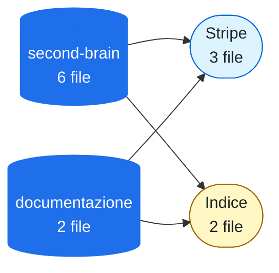

# Grafo della conoscenza

<!-- File generato da .github/kg: non modificarlo a mano, viene riscritto a ogni aggiornamento. -->

**2 repo · 2 documenti · 6 note · 11 concetti · 22 collegamenti**

Le repo (cilindri blu) e i concetti più presenti, con quanti file li citano. Le frecce tratteggiate sono link tra repo. Ogni nome nelle tabelle apre la sua pagina.

Legenda: 🟦 Strumenti · 🟨 Tag

## Repo

| Repo | File | Concetti principali | Ultimo aggiornamento |
| --- | --- | --- | --- |
| [documentazione](_grafo/repo/repo-documentazione.md) | 2 | [Pagamenti](_grafo/concetti/pagamenti.md), [Stripe](_grafo/concetti/stripe.md), [Indice](_grafo/concetti/indice.md) | — |
| [second-brain](_grafo/repo/repo-second-brain.md) 🔒 | 6 | [Stripe](_grafo/concetti/stripe.md), [Inbox](_grafo/concetti/inbox.md), [MePA](_grafo/concetti/mepa.md), , [Demo](_grafo/concetti/demo.md) | — |

## Concetti

| Concetto | Categoria | File | Repo |
| --- | --- | --- | --- |
| [Stripe](_grafo/concetti/stripe.md) | Strumenti | 3 | 2 |
| [Indice](_grafo/concetti/indice.md) | Tag | 2 | 2 |
|  | Da creare | 1 | 1 |
| [Cookie](_grafo/concetti/cookie.md) | Normativa | 1 | 1 |
| [Demo](_grafo/concetti/demo.md) | Tag | 1 | 1 |
| [idea-futura](_grafo/concetti/idea-futura.md) | Da creare | 1 | 1 |
| [Inbox](_grafo/concetti/inbox.md) | Tag | 1 | 1 |
| [MePA](_grafo/concetti/mepa.md) | Organizzazione | 1 | 1 |
| [Pagamenti](_grafo/concetti/pagamenti.md) | Tag | 1 | 1 |
| [Progetto](_grafo/concetti/progetto.md) | Tag | 1 | 1 |
| [Strumenti](20-aree/strumenti.md) | Tag | 1 | 1 |

## Altri modi di vedere il grafo

- **Interattivo, con ricerca e filtri:** apri questa repo in un Codespace: il grafo si apre da solo in una nuova scheda (oppure apri `_grafo/index.html` con il pulsante *Show Preview*).
- **Obsidian (telefono) o Foam (Codespace):** la vista grafo mostra note, documenti di tutte le repo e concetti.
- **Per cercare in fretta:** [indice compatto](_grafo/indice.md) · [manutenzione](_grafo/revisione.md) · [parole chiave suggerite](_grafo/suggerimenti.md)
